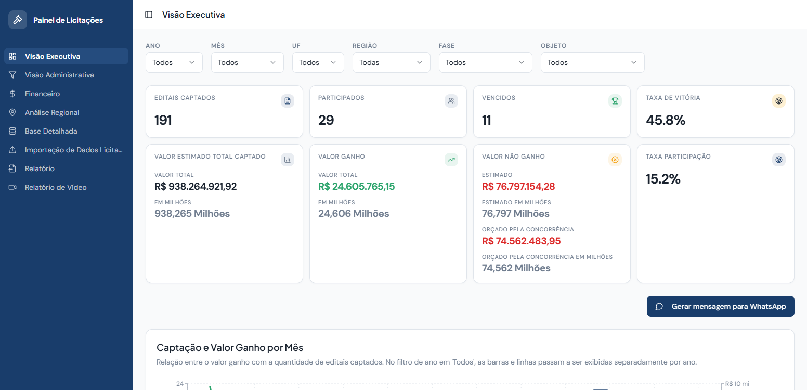
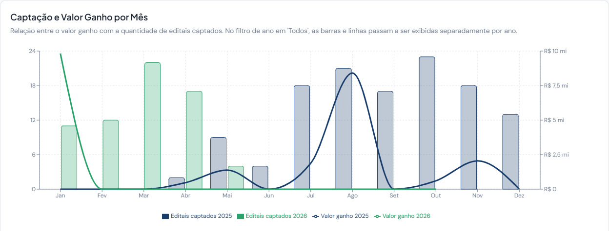
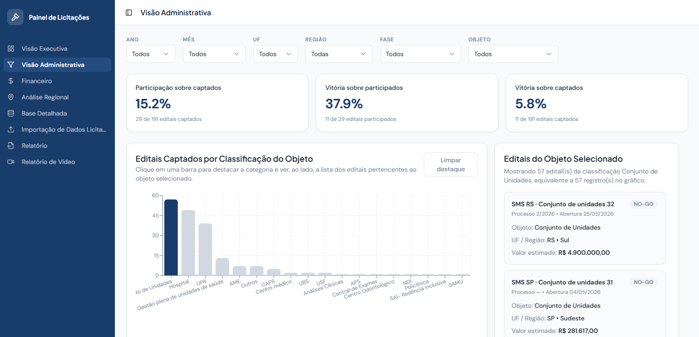
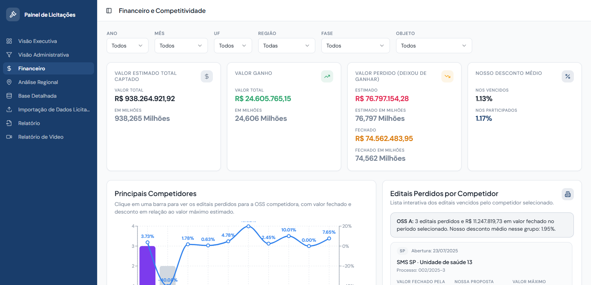
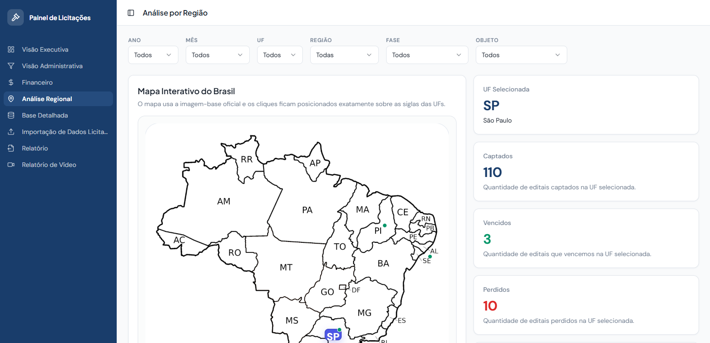

# Painel de Licitações

Painel de acompanhamento das licitações de gestão de unidades de saúde disputadas por uma OSS (organização social de saúde): quantos
editais foram captados, de quais ela participou, quantos venceu, quanto valiam e para quem perdeu.





## O que o painel responde

| Tela | Pergunta |
|---|---|
| **Visão Executiva** | Quantos editais captamos, de quantos participamos e quantos vencemos? Quanto foi ganho e quanto ficou com a concorrência, mês a mês? Gera também um resumo pronto para mandar no WhatsApp |
| **Visão Administrativa** | Onde está o funil (participação sobre captados, vitória sobre participados) e que tipo de unidade aparece mais: hospital, UPA, AME, CAPS, conjunto de unidades... |
| **Financeiro** | Quem são os principais competidores, quantos editais cada um levou e com que desconto, comparado ao nosso desconto |
| **Análise Regional** | Mapa do Brasil clicável: captados, vencidos e perdidos por UF, e os objetos vencidos em cada estado |
| **Base Detalhada** | Todos os editais, filtráveis, com fase, valores, proposta, recurso e impugnação |
| **Importação de Dados** | Envia a planilha (.xlsx, .xls ou .csv) e todos os painéis se atualizam |
| **Relatório** e **Relatório de Vídeo** | Exporta as visões selecionadas, com os filtros aplicados, em PDF ou em vídeo |

Todos os painéis compartilham os mesmos filtros: ano, mês, UF, região, fase e objeto.

| Visão administrativa | Financeiro e competitividade |
|---|---|
|  |  |



## Os dados desta versão

São 284 editais reais, de 2025 e 2026, vindos da planilha de controle (`src/data/mockData.ts`). As licitações
são públicas. Nesta versão do repositório:

- **órgãos e hospitais** viraram `<esfera> <UF> · <tipo de unidade> <nº>` (por exemplo, `SMS SP · UPA 24h 07`),
  com a mesma numeração para o mesmo órgão;
- **as OSS concorrentes** viraram `OSS A`, `OSS B`... (em ordem de quantos editais venceram);
- **a OSS dona do painel** aparece como `Nossa OSS`;
- **os links dos editais** foram retirados, porque trazem o nome do município.

UF, região, datas, fases, valores e as nossas propostas são os da planilha.

## Como rodar

```bash
npm install
npm run dev        # http://localhost:8080
```

Sem configuração nenhuma, o painel usa a base embutida e guarda as importações no navegador.

Para que uma planilha importada valha para todo mundo que abre o painel, ele pode sincronizar com uma tabela no
Supabase: rode `supabase/create_dashboard_data_source.sql` no projeto e preencha o `.env` a partir do
`.env.example`. A política desse SQL deixa a tabela aberta para leitura e escrita. Antes de usar em produção,
coloque autenticação.

## Stack

React 18 · TypeScript · Vite · Tailwind CSS · shadcn/ui (Radix) · Recharts · SheetJS (xlsx) · React Router ·
TanStack Query · Supabase (opcional)

---

Feito por Gabriel Cecci Tardioli.
